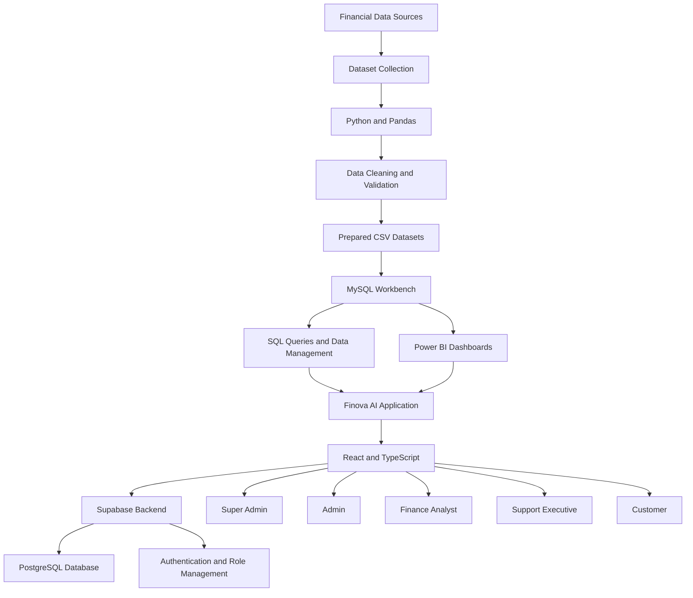
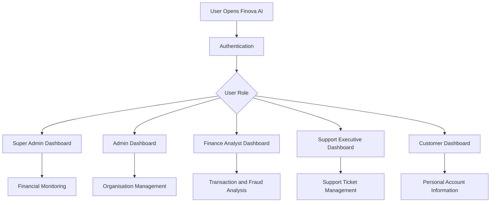
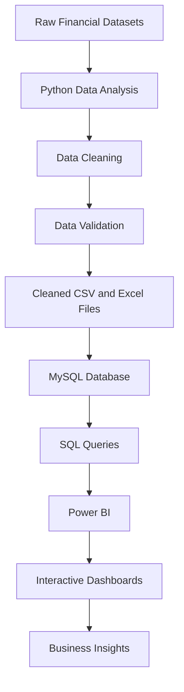

# FINOVA AI — AI-Powered Financial Operations & Analytics Platform

> **Smarter Finance. Faster Operations. Better Decisions.**
>
> An AI-powered financial operations platform for transaction analytics, fraud monitoring, customer support and role-based financial insights.

<p align="center">
  <a href="https://finova-ai-luxury-enterprise-fintech-platform.ai.studio">
    <strong>🌐 Live Application Demo</strong>
  </a>
</p>

## Project Overview

**Finova AI** is an AI-powered financial operations platform designed to help financial organisations manage financial data, monitor transactions, analyse fraud-related activities and improve customer support operations.

The platform combines a web application, structured financial datasets, SQL database management, Python-based data preparation, Power BI dashboards and Supabase backend services.

It provides different dashboard experiences according to user roles, helping administrators, finance analysts, support executives and customers access relevant information.

**Live Application:**  
https://finova-ai-luxury-enterprise-fintech-platform.ai.studio

**Development Environment:** Google AI Studio

---

## 1. System Architecture

Finova AI follows a layered architecture that connects data preparation, database management, analytics and application services.



### Architecture Layers

| Layer | Technology | Responsibility |
|---|---|---|
| Data Collection | Kaggle and other online sources | Financial dataset collection |
| Data Processing | Python, Pandas | Cleaning and validation |
| Development | Jupyter Notebook | Data analysis and preparation |
| Database | MySQL Workbench | Structured data storage and SQL queries |
| Visualization | Power BI | Role-based financial dashboards |
| Frontend | React, TypeScript | Web application and user interface |
| Backend | Supabase | Backend services and database integration |
| Authentication | Supabase Auth | User authentication |
| Version Control | Git and GitHub | Source code management |
| AI Development | Google AI Studio | Application development environment |

---

## 2. Project Technology Stack

### Frontend
- React 19
- TypeScript
- Vite
- Tailwind CSS
- Responsive dashboard interface

### Backend and Database
- Supabase
- PostgreSQL
- Supabase Authentication
- Row Level Security (RLS)
- MySQL Workbench

### Data Analytics
- Python
- Pandas
- Jupyter Notebook
- SQL
- Power BI
- Data cleaning and exploratory data analysis

### Development and Deployment
- Google AI Studio
- GitHub
- Git
- Node.js
- npm

---

## 3. Dataset Collection and Preparation

The project started with collecting financial datasets from online sources, including Kaggle.

The collected datasets were organised according to the requirements of different application roles.

### Data Preparation Workflow

1. Collected financial and customer-related datasets.
2. Examined the dataset structure and columns.
3. Used Python and Pandas in Jupyter Notebook.
4. Performed data cleaning and validation.
5. Checked missing values and duplicate records.
6. Prepared role-wise datasets.
7. Exported cleaned datasets into CSV and Excel formats.
8. Imported the prepared data into MySQL Workbench.
9. Used SQL queries to inspect tables and verify record counts.
10. Connected the data to Power BI for dashboard development.

### Dataset Categories

| Dataset | Purpose |
|---|---|
| Admin Data | Administrative reporting and monitoring |
| Customer Data | Customer information and account analytics |
| Finance and Fraud Data | Transaction and fraud analysis |
| Support Executive Data | Customer support and ticket analytics |

### Original Cleaned Dataset Files

The project data preparation included the following files:

- `cleaned_admin_data_pandas.xls`
- `cleaned_customer_data_pandas.xls`
- `cleaned_finance_analyst&fraud_pandas.xls`
- `Support Executive main FinTech.xlsx`

Only approved and anonymised dataset versions should be shared publicly.

---

## 4. SQL Database Management

MySQL Workbench was used to create and manage the project database.

**Database Name:** `fintech_data`

### Main Tables

| Table | Purpose |
|---|---|
| `admin_data` | Administrative information |
| `customer_data` | Customer information |
| `finance_fraud` | Finance and fraud-related data |
| `support_executive` | Support operations data |

### SQL Operations

The following SQL operations were used to inspect and manage the database:

```sql
USE fintech_data;

SHOW TABLES;

SELECT COUNT(*) FROM admin_data;

SELECT COUNT(*) FROM customer_data;

SELECT COUNT(*) FROM finance_fraud;

SELECT COUNT(*) FROM support_executive;
```

The SQL database was used as a structured source for project analytics and dashboard preparation.

---

## 5. Power BI Dashboards

Power BI was used to create interactive dashboards based on the prepared financial datasets.

The dashboards were organised according to application roles.

### Super Admin Dashboard

- Total transactions
- Total customers
- Total accounts
- Transaction amount
- Suspicious transaction monitoring
- Monthly transaction volume
- Fraud flag distribution
- Account status distribution
- Transaction trends
- AI Sentinel alerts

### Admin Dashboard

- Monthly transaction trends
- Total transaction count
- Flagged transactions
- High-risk transactions
- Customer and account summaries
- KYC status distribution
- Transaction risk distribution
- Transaction type analysis
- Transaction monitoring details

### Finance Analyst Dashboard

- Total transaction count
- Total transaction amount
- Unique customers
- Account status analysis
- KYC status distribution
- Payment method analysis
- Transaction type distribution
- Monthly transaction trends
- Fraud-related insights

### Support Executive Dashboard

- Total support requests
- Open and resolved tickets
- Average resolution metrics
- Ticket status distribution
- Customer segment analysis
- Monthly support requests
- Support ticket details

### Customer Dashboard

- Balance information
- Total transactions
- Pending KYC information
- Risk score
- KYC status
- Transaction overview
- Recent transaction details

**Note:** Dashboard screenshots and figures represent the available project dataset and demonstration environment. They should not be interpreted as actual financial results from a real bank.

---

## 6. Web Application

Finova AI was developed using Google AI Studio with a React and TypeScript application structure.

### Main Application Features

- Modern financial operations interface.
- Role-based dashboard navigation.
- Super Admin and Admin sections.
- Finance Analyst dashboard.
- Support Executive dashboard.
- Customer dashboard.
- Financial analytics and visualisations.
- User and staff management.
- Backend integration using Supabase.
- Responsive application layout.

### User Roles

| Role | Main Responsibility |
|---|---|
| Super Admin | Overall platform and workspace management |
| Admin | Organisation-level administration |
| Finance Analyst | Transaction and fraud analysis |
| Support Executive | Customer support operations |
| Customer | Personal financial information and services |

---

## 7. Supabase Backend Integration

Supabase is used as the backend service for the Finova AI application.

### Main Backend Responsibilities

- User authentication.
- User profile management.
- Role-based access.
- PostgreSQL database services.
- Backend data integration.
- Row Level Security policies.
- Application data management.

### Database Security

- Authenticated access to protected application areas.
- Role-based permissions.
- Tenant-level data isolation where configured.
- Restricted access to privileged backend operations.
- Environment-based secret management.

The actual database schema and enabled security policies should be reviewed before deployment.

---

## 8. Application Workflow



---

## 9. Data Analytics Workflow

The data analytics process connects Python, SQL and Power BI.



This workflow helps transform raw financial data into structured information and visual insights.

---

## 10. Installation and Local Setup

### Prerequisites

- Node.js
- npm
- Git
- MySQL Workbench
- Python
- Jupyter Notebook

### Clone the Repository

```bash
git clone YOUR_GITHUB_REPOSITORY_URL

cd Finova-AI
```

### Install Dependencies

```bash
npm install
```

### Configure Environment Variables

Create a local environment file using the variable names required by your application.

Example:

```env
VITE_SUPABASE_URL=your_supabase_project_url
VITE_SUPABASE_ANON_KEY=your_supabase_anon_key
GEMINI_API_KEY=your_gemini_api_key
```

Use only the variables actually required by the application. Keep private credentials on the server side.

### Run the Application

```bash
npm run dev
```

### Build the Application

```bash
npm run build
```

---

## 11. Project Repository Structure

```text
Finova-AI/
│
├── src/
│   ├── components/
│   ├── pages/
│   ├── services/
│   └── ...
│
├── public/
│   └── assets/
│
├── scripts/
│
├── supabase/
│   └── migrations/
│
├── supabase-schema.sql
├── package.json
├── tsconfig.json
├── vite.config.ts
├── .env.example
└── README.md
```

Additional folders such as `datasets/` and `notebooks/` can be included when the approved project files are added to GitHub.

---

## 12. Team Contributions

**Team Size:** 3 Members

| Team Member | Role | Main Contribution |
|---|---|---|
| Y Aravind Reddy | Team Leader – AI App and Integration Lead | Website development, Google AI Studio, SQL database work, application integration, GitHub and Super Admin dashboard |
| P. Sandhya Reddy | Team Member | Assigned Power BI dashboard development and data analysis |
| Ram Karthik | Team Member | Assigned Power BI dashboard development and data analysis |

The team collaborated on dataset preparation, database organisation, analytics and application development.

---

## 13. Project Development Milestones

| Phase | Work Completed |
|---|---|
| Dataset Preparation | Data collection, cleaning and role-wise organisation |
| Database Development | MySQL database and table creation |
| Data Analysis | Python and Pandas analysis |
| Dashboard Development | Role-based Power BI dashboards |
| Web Application | Finova AI website development |
| Backend Integration | Supabase integration |
| Version Control | GitHub repository and source code management |
| Demonstration | Website, SQL and dashboard demonstrations |

---

## 14. Project Applications

Finova AI demonstrates how financial data can be organised and used for:

- Financial transaction monitoring.
- Fraud-related analysis.
- Customer account analytics.
- Administrative reporting.
- Customer support monitoring.
- Role-based business intelligence.
- Data-driven financial operations.

---

## 15. Future Scope

- Advanced AI-powered financial analysis.
- Improved fraud detection models.
- Automated transaction categorisation.
- Enhanced customer support assistance.
- Document processing and KYC workflows.
- Advanced analytics and reporting.
- Improved monitoring and security.

---

## 16. Project Information

| Field | Details |
|---|---|
| Project Name | Finova AI |
| Domain | FinTech |
| Project Type | AI-Powered Financial Operations Platform |
| Internship | Ziro Digital Internship Program |
| Development Environment | Google AI Studio |
| Frontend | React and TypeScript |
| Backend | Supabase |
| Databases | MySQL and PostgreSQL |
| Data Processing | Python and Pandas |
| Data Analysis | Jupyter Notebook |
| Visualisation | Power BI |
| Version Control | GitHub |
| Team Size | 3 Members |

### Project Links

**Live Application:**  
https://finova-ai-luxury-enterprise-fintech-platform.ai.studio

**GitHub Repository:**  
Add your repository URL here.

**Power BI Dashboards:**  
Add your published dashboard links, if available.

**Project Presentation:**  
Add your presentation link, if available.

---

## 17. Acknowledgements

This project was developed as part of the Ziro Digital Internship Program.

We thank our mentors, team members and the technology platforms that supported the development of Finova AI.

---

<p align="center">
  <strong>FINOVA AI — Data. Intelligence. Better Decisions.</strong>
</p>

<p align="center">
  AI-Powered Financial Operations & Customer Service Platform
</p>
